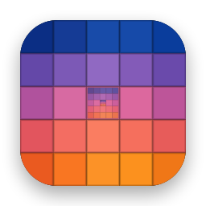

<p align="center">
  
</p>

<h1 align="center">Mosaic</h1>

<p align="center">
  <a href="https://github.com/vastunghia/mosaic-screensaver-revived/releases"></a>
  <a href="#what-you-need"></a>
  <a href="LICENSE"></a>
</p>

<p align="center">
  <a href="https://vastunghia.github.io/mosaic-screensaver-revived/"><b>Website</b></a> ·
  <a href="https://github.com/vastunghia/mosaic-screensaver-revived/releases/latest"><b>Download</b></a> ·
  <a href="https://github.com/vastunghia/mosaic-screensaver-revived/discussions"><b>Discussions</b></a> ·
  <a href="https://ko-fi.com/vastunghia"><b>Support</b></a>
</p>

<p align="center">
  The Mosaic screen saver from Mac OS X Leopard, rebuilt from scratch for macOS 15 and later,
  on your own photographs.
</p>

<p align="center">
  
</p>

An endless zoom outwards: every photograph turns out to be one tile of a larger mosaic,
which makes up another photograph, which is one tile of the next mosaic, and so on.
Apple shipped it in Mac OS X 10.5 and dropped it in 10.8. Nothing of the original survives
on today's macOS, so this is a clean-room reimplementation, drawn with Metal.

Mosaic comes with **Mosaic Companion**, the app that installs the screen saver, prepares
your photographs for it and keeps its settings, since a screen saver cannot read the
Photos library by itself. Your photographs stay on your Mac, and the library is only ever
read.

**At a glance**

- Aesthetics-aware photo selection
- Face-aware cropping
- Screenshots filtered out
- Smart *Optimize Mac Storage* support
- Smooth 60 fps, even on old Macs
- Private and secure, and you can check: open source

For a fuller description of these features, see [What's in it](#whats-in-it) and
[Privacy and security](#privacy-and-security) below.

## What's in it

### Your photographs

- **The whole library, or just some albums.** Pick albums and folders as Photos shows them
  in its sidebar; a chosen folder also takes the albums you add to it later. Or use any
  folder of images outside the library, subfolders included.
- **A selection that renews itself.** Up to 8,192 photographs, spread evenly over the years,
  the most recent, or at random. Every week (or every day, every month, or never) Mosaic
  picks others; the new set is prepared in the background and goes on screen only once it
  is complete.
- **Fewer screenshots and receipts.** Screenshots, photographs of documents, receipts and
  notes, and the tenth of each month's photographs that Photos itself rates lowest are left
  out, and others take their place. Mosaic uses the scores Photos has already computed and
  judges the rest on your Mac. One switch turns it off.
- **Kept up to date in the background.** Opened at login, Mosaic Companion runs without a
  window, at low priority, and follows the changes in your library.

### The effect

- **Smooth at full screen.** 60 frames per second, on old Macs too. The next
  mosaic is computed in the background, so the zoom never waits for it, and frames are
  paced for displays with a variable refresh rate.
- **Mosaics that resemble the photograph.** Each tile is chosen by colour, measured the way
  the eye perceives it, with rules that keep a photograph from repeating close to itself.
- **Sharp up close.** As the zoom reaches the next photograph, its tile is replaced by a
  1920-pixel copy, and the tiles around it by sharper ones too: the photograph that fills
  the screen is never an enlarged thumbnail.
- **Faces stay in the frame.** Portrait photographs are cropped to the shape of the screen
  around the faces in them, found on your Mac.

### Libraries kept in iCloud

- **Works with *Optimize Mac Storage*.** Mosaic uses what Photos keeps on your Mac, down to
  the small previews, which become tiles, and makes sure at least one photograph in
  sixteen can fill the screen.
- **Downloads only if you allow them, and within limits.** If you do, Mosaic Companion asks
  Photos for a sharp copy, about 1.3 MB and never the original, of the photographs it shows
  full screen and of some of those shown large around them. At most 256 copies a day and
  512 a week, none on a personal hotspot or in Low Data Mode; a copy that takes longer than
  15 seconds is skipped and tried again later, and downloads pause when iCloud stops
  answering. Lifting the limits early asks for confirmation, after saying how many copies
  and how many megabytes it means.

### The app

- **A guided setup.** It moves the app to Applications if needed, installs the screen saver,
  and asks for each permission only when it is needed, saying what it is for. Afterwards
  the window shows what the screen saver has, with a button for whatever is missing.
- **Updates itself.** Once a day Mosaic Companion checks GitHub for a new version, verifies
  it, and installs it, screen saver included, when you say so. If its window is closed, a
  notification tells you.
- **In five languages.** English, French, German, Italian and Spanish, for the app, the
  screen saver and the built-in guide (**Help › Mosaic Companion Help**).
- **Universal.** One build for Intel and Apple silicon Macs.

## Privacy and security

- **The Photos library is only read.** macOS has no read-only permission for the whole
  library, so Mosaic Companion asks for the access macOS offers; it uses it to read. Its code
  contains no call that changes photographs, albums or their details, and the quality scores
  come from the library's database opened read-only.
- **Small copies, kept in your account.** What the screen saver shows are reduced copies of
  your photographs (854 pixels wide for tiles, 1920 for close-ups), stored in
  `~/Library/Application Support/Mosaic`: about 1.2 GB for 2,048 photographs. That folder is
  inside your user Library, which macOS keeps readable by you alone; other accounts on the
  same Mac cannot open it.
- **The screen saver never touches the library.** It runs inside Apple's sandboxed screen
  saver host and reads only those copies.
- **One connection, to GitHub.** The only server Mosaic Companion contacts is GitHub, once a
  day, to look for a new release and download it. There are no analytics, no accounts and
  no tracking, and nothing about you or your photographs is sent anywhere. Faces and photo
  quality are judged on your Mac. If you allow downloads from iCloud, Photos fetches the
  copies itself, as it does when you open a photograph.
- **Updates are verified before they are installed.** A new version must carry the same
  developer signature as the one you have, and match its published checksum; anything else
  is refused.
- **Open source.** All the code is in this repository, under the MIT license: you can read
  what it does, and [build it yourself](#building-from-source) instead of trusting the
  downloaded copy.

> [!WARNING]
> **The screen saver shows your photographs while you are away.** Mosaic uses every
> photograph in your library, or in the albums you chose, except those you have hidden in
> Photos and those in Recently Deleted. A photograph you would rather nobody saw can
> therefore fill the screen when the screen saver starts, perhaps while you are not at your
> desk. Hide such photographs in Photos, or choose only the albums you want Mosaic to use.
> With a folder, Mosaic uses every image in it.

## What you need

- macOS 15 Sequoia or later, on an Intel or Apple silicon Mac.
- Photographs: your Photos library, or a folder of them. At least 100; a couple of
  thousand look best.

Mosaic has been tested on Intel and Apple silicon Macs, with macOS 15 and macOS 26, on
administrator and standard accounts, and with libraries kept in iCloud. It shows its mosaic
on the main display; other displays stay black.

## Installing

1. Download `Mosaic-x.y.dmg` from the [latest release](https://github.com/vastunghia/mosaic-screensaver-revived/releases/latest),
   open it and drag **Mosaic Companion** to **Applications**.
2. Open Mosaic Companion from Applications. macOS says *"Mosaic Companion" Not Opened*:
   choose **Done**.
3. Open **System Settings › Privacy & Security**, scroll down to *"Mosaic Companion" was blocked
   to protect your Mac* and choose **Open Anyway**, then confirm with your password
   (an administrator's, on an account that is not one).
   You only do this once.\*
4. Mosaic Companion opens on its setup, a page at a time:
   - **Photographs** — allow access to your Photos library, or choose a folder. Mosaic Companion
     starts preparing the photographs by itself, and the mosaic appears in its window as
     soon as 100 are ready;
   - **Screen Saver** — **Install**;
   - **In the Background** — let Mosaic Companion open at login, without a window, to keep the
     screen saver's photographs up to date as your library changes;
   - **Photos in iCloud** — whether to download sharp copies of the photographs this
     Mac keeps only in iCloud;
   - **Updates** — allow the notification that says a new version is ready;
   - then choose **Mosaic** in the Screen Saver settings, under *Other*. On macOS 26 they
     are behind the **Screen Saver** button of **System Settings › Wallpaper**, which is
     where Mosaic Companion takes you.

   **Mosaic Companion › Set Up Mosaic…** goes through it again.

\* Mosaic Companion is signed, but not notarized by Apple, which takes a paid developer
membership. macOS therefore asks you, once, whether you trust it. If you would rather not,
[build it yourself](#building-from-source).

## Using it

The Mosaic Companion window shows the mosaic moving; click it, or press **⌘↩**, to watch it
full screen. **Mosaic Companion › Settings…** (⌘,) holds the choices described above: which
photographs and how many, how often they change, what to leave out, what to download from
iCloud, how many rows a mosaic has and how long each zoom lasts.

The full guide is inside the app, under **Help › Mosaic Companion Help**, and always matches
the version you have. The French, German and Spanish translations have not been checked by
a native speaker yet: if something reads wrong, please open an issue.

## Uninstalling

Quit Mosaic Companion, then delete:

- `/Applications/Mosaic Companion.app`
- `~/Library/Screen Savers/Mosaic.saver`
- `~/Library/Application Support/Mosaic`

and remove Mosaic Companion from **System Settings › General › Login Items & Extensions**, if
it is still there. From a clone of this repository, `./scripts/uninstall.sh` does all of it
and also resets the Photos and notification permissions; photographs and the Photos library
are never touched.

## Building from source

You need Xcode 26 or later, selected as the active developer directory, and its Metal
Toolchain, which Xcode downloads separately; the Command Line Tools alone cannot compile
the shaders. The build scripts check for both before compiling anything.

```sh
sudo xcode-select -s /Applications/Xcode.app
xcodebuild -downloadComponent MetalToolchain
```

```sh
./Hosts/App/build.sh --install   # builds the app (with the screen saver inside) into /Applications
./scripts/release.sh             # the universal app on a disk image, as released
swift test
```

On an account that is not an administrator, `--install` asks for an administrator's name
and password, since only administrators can write to `/Applications`.

Signing matters more than usual here, because the Photos permission is tied to the app's
signature. With an *Apple Development* certificate in your keychain the build is signed
with it, and macOS remembers the permission from one build to the next. Without one, the
build falls back to an ad-hoc signature, which works but asks for the permission again
after every build.

How the effect is put together, and the tools used to tune it, are in
[docs/DEVELOPING.md](docs/DEVELOPING.md).

## Credits

The photographs in the video come from the [WordPress Photo Directory](https://wordpress.org/photos/),
which publishes them under CC0. `scripts/fetch-demo-corpus.swift` downloads the same 2,048
photographs, with a `credits.csv` that links each one to its page.

Mosaic is an independent tribute to a screen saver Apple made, and is not affiliated with
or endorsed by Apple.

## How it was made

Mosaic was written with an AI coding assistant, Claude Code, in what is often called vibe
coding: I described what I wanted, made the design decisions and judged the results, but I
did not review the code line by line. To keep control of it I built it one part at a time,
each with a written specification of its own, and tested every part before moving on, on
real libraries of tens of thousands of photographs, on Intel and Apple silicon Macs, on
macOS 15 and 26, on standard accounts and on libraries kept in iCloud. Bugs surely remain;
if you find one, please open an issue.

## Supporting Mosaic

If you like Mosaic, please give it a star on GitHub: it helps other people find it. And if
you'd like to chip in a few dollars on [Ko-fi](https://ko-fi.com/vastunghia), they will go
towards the Apple Developer Program ($99 a year), so that future releases can be notarized
and open without the **Open Anyway** step.

## License

[MIT](LICENSE).
